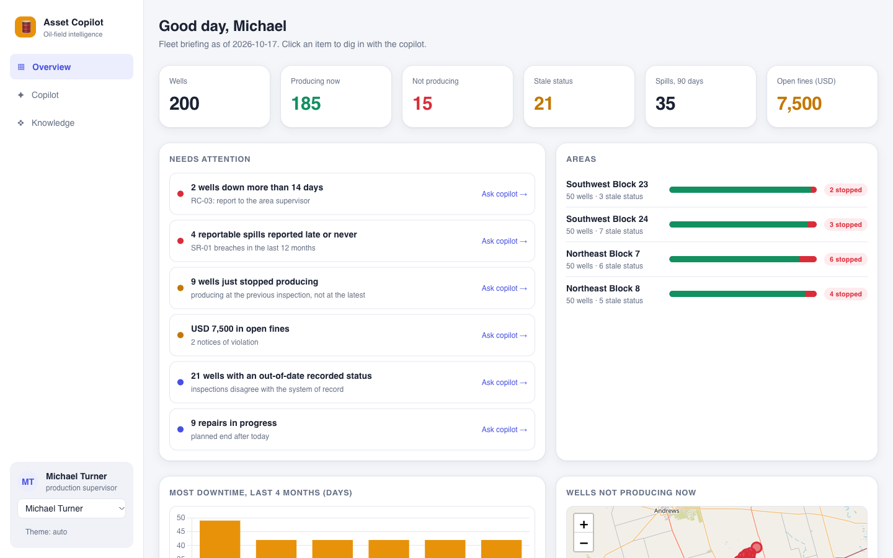
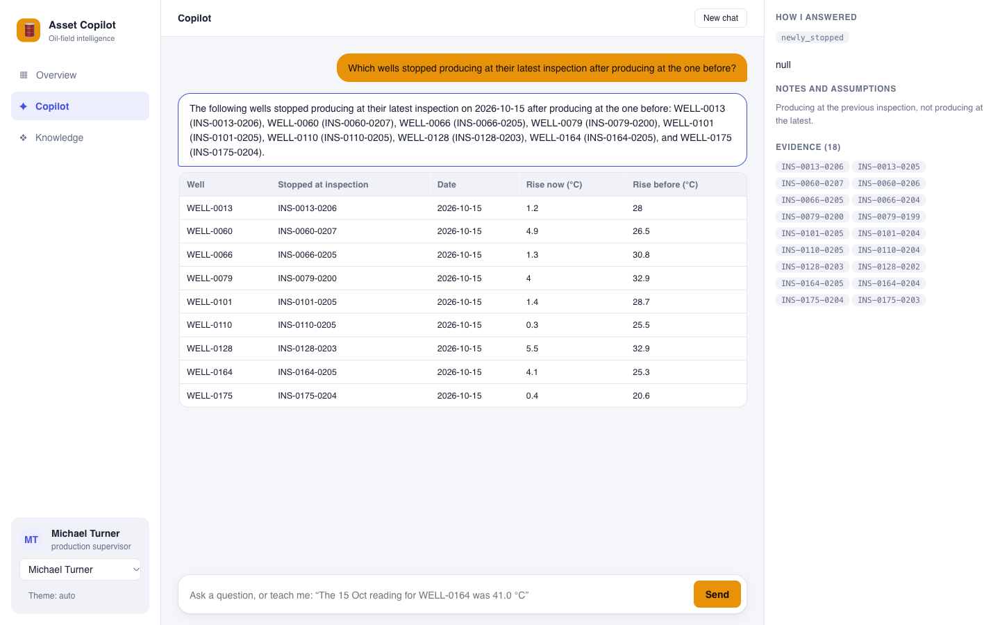

# Asset Intelligence Copilot

FlytBase Hacktoberfest 2026 Hack Day challenge. A chat copilot that answers operators' plain-English questions about oil wells, with evidence, generative UI, memory and feedback.





**Design in one line:** typed, deterministic tools do all the arithmetic and rule application over the data; the LLM only routes a question to a tool and writes the summary from the tool's result; code checks the prose before it is shown.

## Run it
```
uv venv .venv && uv pip install -p .venv/bin/python -r requirements.txt
git clone https://github.com/FlytBaseAILabs/flytbase-ahc-swe-asset-intelligence-dataset data/repo      # dataset repo: sample-data/ and test-data/
cp .env.example .env     # OPEN_ROUTER_API_KEY (fallback models), OMNI_LIVEKIT_* (voice); Vertex AI uses gcloud application-default credentials
set -a; . ./.env; set +a
.venv/bin/uvicorn copilot.server:app --port 8000      # backend + UI   -> http://localhost:8000
.venv/bin/python voice/agent.py dev                   # optional: voice worker (LiveKit + Gemini Live)
cd web && npm install && npm run dev                  # optional: CopilotKit front end -> http://localhost:3000
```
The server now defaults to the **test data** (`DATA_DIRS=data/repo/test-data/dataset`, `COPILOT_TODAY=2027-01-15`); to use the sample set `DATA_DIRS=data/repo/sample-data COPILOT_TODAY=2026-10-17`. Several roots can be listed with commas. Final questions: `./scripts/final_run.sh data/repo/test-data/dataset tests/final_questions.txt RESULTS.md` (see `docs/RUNBOOK_FINAL.md`); full answers with visuals are saved in `RESULTS.json`.

## What is in the app (http://localhost:8000)
| Page | What it shows |
|---|---|
| **Overview** | Zero-prompt fleet briefing: KPIs, "needs attention" (each item opens the copilot), area health, downtime chart, map of stopped wells, spill heatmap; *Print briefing* |
| **Copilot** | Several parallel chats per user with persistent history (sidebar accordion); chat with interactive visualization blocks per answer (sortable/filterable tables, CSV, chart toggles, click-to-ask), clarify option buttons, read-aloud, *Add to report*, and a side panel: how the answer was produced, **context used** (real tokens), evidence |
| **Wiki** | A living page per well, per well type and one central fleet page: live cited facts + model-written insights checked against the facts |
| **Knowledge** | Everything users taught the copilot (corrections, rules, notes, claims), with status and Revoke |
| **Audit** | Context, Answers vs expected, Traces, Evaluations, **Vector store** (Chroma), Data & ingest, Rules, Tools, Prompts & models, Memory, Health |
| **Architecture** | The 11 Mermaid diagrams of `docs/DIAGRAMS.md` with live counts |
| **Report** | Pin answers (or the briefing) into a printable report; optional checked executive summary; Print / Save as PDF |
| **For judges** | Requirement -> feature -> where to see it -> live evidence |

**Voice:** the round 🎙 button (bottom-right of every page). A LiveKit agent talks through Gemini Live (`gemini-live-2.5-flash-native-audio`) and answers by calling the same `/api/ask` (same planner, same tools, same memory); live captions in the dock; visual answers appear in the chat.

## How it works
- `copilot/data.py` loads any number of dataset roots, merges by ID, follows report files, parses thresholds and deadlines out of the manual/SOP text (with section provenance and warnings, never crashes).
- `copilot/tools.py`, `tools2.py`, `causes.py`, `sqltool.py`: 45 deterministic tools (status, downtime, spills, costs, RCA, compliance, root causes, trace, fleet analytics, a last-resort read-only SQL tool) and `ops.py` with the Operations-SOP tools: gas response (OPS-1), bypass vs MOC memos (OPS-2), status precedence (OPS-3), heat-trace (OPS-5), regulator-letter audit, recalled pumps, delay reasons, note watch-list, prioritisation, honest 'data not in the set' answers.
- `copilot/agent.py`: planner (1 LLM call -> JSON plan), executor, statement handlers (corrections with selectors, rules, notes, claims, revoke, confirm large changes), writer, grounding guard, `critic.py` sub-agent (stronger model reviews the draft), clarification loop (`COPILOT_CLARIFY=ask|auto`).
- `copilot/blocks.py`: deterministic composition of 4-8 visualization blocks per answer; `static/js/blocks.js` renders them (shared by the plain UI, the CopilotKit UI and the report).
- `copilot/memory.py`: SQLite audit log of corrections/rules/notes (overlay, never overwrite) and per-user conversation history (entity IDs, timestamps).
- `copilot/search.py`: hybrid retrieval: BM25 + `text-embedding-005` vectors in **Chroma** (persistent, metadata filters), embedding cache on disk, passage-level chunks.
- `copilot/store.py`: DuckDB system of record; `copilot/wiki.py`, `copilot/audit.py`, `copilot/briefing.py`: wiki pages, audit endpoints, dashboard.
- `static/`: build-free UI (ES modules, CSS tokens, light/dark). `web/`: optional CopilotKit + AG-UI front end (`copilot/agui.py`). `voice/`: LiveKit voice agent.
- Details: `docs/ARCHITECTURE.md` (design), `docs/DIAGRAMS.md` (visual guide), `docs/QA_REPORT.md` (real answers vs expected, generated), `WRITEUP.md` (2-page submission).

## Tests and QA (how answers are verified)
| Suite | Command | What it checks |
|---|---|---|
| golden | `python tests/golden.py` | tools vs the challenge's expected values + a SQL cross-check (no LLM) |
| extra (22) | `python tests/extra/run.py` | medium/complex scenarios vs independent pandas ground truth |
| design review (29, 10 core) | `python tests/chat/run.py [core]` | stateful: corrections, recall, privacy, concepts, clarification, robustness |
| blocks / sql / context / embeddings / critic | `tests/blocks_test.py`, `sql_test.py`, `context_test.py`, `search_test.py`, `critic_test.py` | composition, SQL safety, token accounting, retrieval, reviewer |
| router benchmark | `python tests/bench_router.py` | tool choice, Gemini vs Gemma 4 (`COPILOT_BACKEND=gemma`) |
| LLM judge | `python tests/qa/run_answers.py --judge` | 26 given questions graded 1-5 on five criteria by a stronger model; `tests/qa/report.py` writes `docs/QA_REPORT.md` |
| UI syntax | `python tests/ui_syntax_test.py` | every front-end module parses |

Results are saved to `tests/results/*.json` and shown in Audit > Evaluations. Honest reading: the scenario suites were written by the builder and tuned against failures, several checks involve a model so results can vary between runs, and the unseen final questions are the real test.

## Docs and PDFs
`./scripts/build_docs.sh` builds `WRITEUP.pdf`, `docs/DIAGRAMS.pdf`, `docs/ARCHITECTURE.pdf` and the QA report from the Markdown (Mermaid via headless Chromium; see `docs-tools/README.md`).
Notes: `docs/notes/CHALLENGE.md` (the brief and dataset guide), `docs/notes/IDEAS.md` (idea triage).

License: MIT
