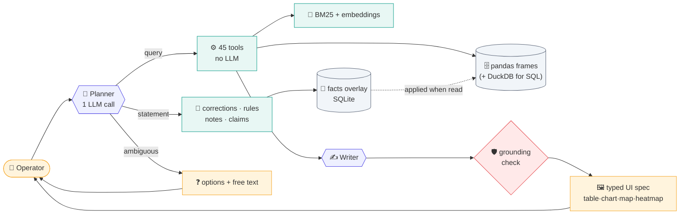

# Asset Intelligence Copilot: write-up

## Page 1: System design

**Principle.** Numbers and rules come from deterministic code over typed stores. The LLM only routes a question to a tool and writes the summary from that tool's
result, so it never sees raw data. A guard rejects any sentence whose IDs or numbers are not in the result.

**Data and indexing.** One re-runnable ingest loads any number of dataset roots, merges by ID, follows each repair's `report_file`, and parses thresholds from the
manual/SOP text with their section (15/20/25 °C per well type, 5 bbl, SR-01 24 h before / 12 h from 1 Jan 2027, 4 h, 60 days, 30 days, RCA count), warning instead of crashing if wording differs. Facts that exist only in
prose are lifted into columns (containment hours, root cause). Records are pandas frames, persisted to DuckDB; documents are chunked with applicability metadata and searched hybrid
(BM25 for exact tokens like `SR-02`, embeddings for paraphrase). No vector server or graph DB: links are plain IDs and `trace()` walks them.

**Test-data additions, no question-specific code.** `data_correction` notes override recorded values (originals kept), `type_history` picks the threshold in force at each reading, `team_history` the current team, plugged wells leave "not producing", report `Parts installed` lines (pump, serial, lot) become columns, MOC memos / the recall notice / the regulator letter are parsed from their text, and operator notes are classified by phrase (gas odor, bypass in/out, shut-in/restart). Eleven new typed tools apply the Operations SOP (OPS-1 gas response, OPS-2 bypass vs MOC, OPS-3 status precedence, OPS-5 heat trace), the letter, the recall, delay reasons and a note watch-list.

**Tools.** well_status, wells_not_producing, timeseries, spills, downtime, repair costs/summary, RCA candidates, compliance (SR-01..03, RC-01..04), trace, wells_by_cause (concept
questions: root causes judged against ~25 distinct phrasings, then aggregated; a word that never occurs, like "mud", returns grounded options with counts), plus fleet analytics.
Producing = wellhead minus ambient ≥ the type threshold; downtime = 7 days per non-producing weekly inspection; "today" is one config value.

**Memory and feedback.** Feedback becomes a typed, append-only record (selector, op, value, author, reason); the effective view is raw rows plus active corrections (specific scope wins, overlaps reported, superseded/revoked kept for audit).
Corrections never overwrite data: a selector (wells, area, type, dates, filters) is evaluated when read, so one feedback can change many rows and "undo" restores them. Large changes ask
for confirmation first. Rules are scoped to a well type and labelled as the user's rule, not the manual. Claims are compared with the latest inspection and stored confirmed or
unconfirmed; conflicting users are shown side by side. Private memory is a per-user log (time, tool, entity IDs), so "the three wells we discussed in April" resolves only from that user's
history by time and count; several matches are offered as options. **Clarification:** one short question with 2-4 options plus free text, only when a wrong guess would change the answer;
in `auto` mode (graded run) it never asks and states its assumption.

**Models and cost.** Gemini 2.5 Flash on Vertex AI routes (about 2.1k fixed prompt tokens) and writes (at most 7k characters of facts); a critic sub-agent on Gemini 2.5 Pro reviews each written answer: about 3 model calls and ~3-4k tokens per answer, measured per call in the UI. Gemma 4 26B-A4B on
Vertex is selectable; router-only benchmark over 40 questions: 40/40 (Gemini) vs 35/40 (Gemma 4) on the last run. Free OpenRouter models are the fallback.
**Verification.** Before the test data: 18 given + 22 extra + 29 design-review scenarios on the sample data (latest run: extra 22/22, design-review 29/29, golden 18/18) with expected values computed independently from the raw files, and an LLM judge that graded 41 of 49 saved answers pass (0 errors; same vendor family as the models, so treat as a second opinion). Test-data counts were re-derived with separate code.
**Also built.** A wiki page per well, type and fleet (live facts + cited, checked insights), an Audit view (traces, evaluations, lineage, rules, tools, prompts, memory), a voice front door (LiveKit + Gemini Live calling the same API), read-aloud narration and a CopilotKit add-on. **Next.** Compiled insights for every well in bulk, alerts and incident reports.

## Page 2: Results on the final questions (test data, today = 15 Jan 2027)

Run in order by `tests/run_final.py` (fresh memory, no code change to ingestion, auto-clarify). All 21 turns with their visuals are in `RESULTS.json` / `RESULTS.md`. Below: the hardest and best-evidenced ones. Counts were re-derived from raw files with separate code (gas notes 26, 9 missed; recalled pumps 9, 8 after the reported swap).

**Q5 Regulator letter** (reportable spills, NE-7/8, since 1 Jun, volumes after corrections; compliant only if the clean-up report says "Soil samples sent to the lab."): 3 of 6 not compliant.

| Well | Area | Inspection | Volume | Clean-up job | Compliant? |
|---|---|---|---|---|---|
| WELL-0168 | NE- 8 | INS-0168-0190, 2026-06-11 | 5.6 bbl | MNT-0168-024 | Yes |
| WELL-0123 | NE- 7 | INS-0123-0093, 2026-09-24 | 6 bbl | MNT-0123-014 | **No**: no "Soil samples sent to the lab." line |
| WELL-0277 | NE- 7 | INS-0277-0205, 2026-10-01 | 6.2 bbl | MNT-0277-031 | Yes |
| WELL-0119 | NE- 7 | INS-0119-0209, 2026-11-05 | 6 bbl | MNT-0119-029 | Yes |
| WELL-0182 | NE- 8 | INS-0182-0208, 2026-12-03 | 5.2 bbl | MNT-0182-028 | **No**: no "Soil samples sent to the lab." line |
| WELL-0262 | NE- 8 | INS-0262-0218, 2027-01-07 | 6.1 bbl | MNT-0262-029 | **No**: no "Soil samples sent to the lab." line |

**Q4 Flowline bypasses** (operator notes vs MOC memos; MOC-044 extends MOC-031 to 28 Feb 2027; expiry runs to the end of that day): 3 expired, 2 never approved. Still in today: WELL-0249 (expired), WELL-0405 (unapproved), WELL-0248 (allowed).

| Well | Area | Bypass in | Bypass out | Approval | Approval valid until | Status |
|---|---|---|---|---|---|---|
| WELL-0087 | SW-24 | 2026-12-02 | 2027-01-06 | MOC-2026-036 | 2026-12-15 | **Expired** |
| WELL-0158 | NE-8 | 2026-11-20 | 2026-12-28 | MOC-2026-036 | 2026-12-15 | **Expired** |
| WELL-0249 | SE-31 | 2026-11-25 | **still in** | MOC-2026-036 | 2026-12-15 | **Expired** |
| WELL-0405 | NW-12 | 2026-12-20 | **still in** | none | - | **Not approved** |
| WELL-0561 | SE-32 | 2026-12-08 | 2026-12-19 | none | - | **Not approved** |
| WELL-0013 | SW-23 | 2026-11-10 | 2027-01-08 | MOC-2026-044 | 2027-02-28 | Allowed |
| WELL-0062 | SW-24 | 2026-11-02 | 2026-11-27 | MOC-2026-044 | 2027-02-28 | Allowed |
| WELL-0248 | SE-31 | 2026-11-05 | **still in** | MOC-2026-044 | 2027-02-28 | Allowed |
| WELL-0284 | SW-24 | 2026-11-12 | 2026-12-10 | MOC-2026-036 | 2026-12-15 | Allowed |
| WELL-0356 | NW-12 | 2026-11-18 | 2026-12-05 | MOC-2026-036 | 2026-12-15 | Allowed |
| WELL-0461 | SE-32 | 2026-11-14 | 2026-12-12 | MOC-2026-036 | 2026-12-15 | Allowed |
| WELL-0476 | SE-32 | 2026-10-22 | 2026-11-18 | MOC-2026-044 | 2027-02-28 | Allowed |

**Q10 What are we waiting on** (jobs started 2026; share of the area's delayed jobs / typical extra days, from the report sentences). Contractor slots in Southeast 31 stand out (25% of its delays, 15.5 d vs about 9 d elsewhere); Northeast 8 has the highest share of delayed jobs (15%, mostly crews on spill response, 14 d). Stacked chart in the UI.

| Area | Parts back-ordered | Weather (road impassable) | Contractor slot | Crew on spill response | Workover rig busy |
|---|---|---|---|---|---|
| Northeast 7 | 23% / 15 d | 23% / 9 d | 23% / 8 d | 17% / 16 d | 12% / 12 d |
| Northeast 8 | 16% / 10 d | 22% / 8 d | 21% / 9 d | 24% / 14 d | 16% / 8 d |
| Northwest 12 | 17% / 9 d | 21% / 9 d | 16% / 9 d | 21% / 8.5 d | 25% / 9 d |
| Southeast 31 | 15% / 8.5 d | 20% / 12.5 d | 25% / 15.5 d | 8% / 2 d | 32% / 14 d |
| Southeast 32 | 19% / 9.5 d | 22% / 8 d | 23% / 9 d | 15% / 10 d | 21% / 9 d |
| Southwest 23 | 22% / 12.5 d | 22% / 9 d | 17% / 12.5 d | 19% / 7 d | 19% / 8 d |
| Southwest 24 | 18% / 8 d | 23% / 10 d | 26% / 8 d | 12% / 12 d | 21% / 13.5 d |

**Q8 Who told you that** (memory and provenance). Nathan: his own statement that WELL-0333's pump was swapped is applied and attributed ("no work order yet"); his "sort by area then well ID, costs in thousands" is stored for him only. Robert then sees **8** recalled pumps, with a note that WELL-0333 is counted as replaced on Nathan's word. Olivia's "Nathan told me WELL-0577 was swapped" is recorded as **unverified and not applied**. Nathan's own list shows 3 pumps in Northwest Block 12 sorted by area/ID with install cost in thousands (WELL-0305 24.5, WELL-0426 24.0, WELL-0428 27.1) and says which preference was used.

**Q9 One conversation, six turns.** 8 pumps by area; Nathan Pierce leads Northwest Production (150 active wells); OPS-5 misses in December (WELL-0310, 0354, 0486, 0531; the question's "one well" is really four); for the 3 Dec gas smell at WELL-0332 there is **no H2S reading** (the note only says gas, no job or manual inspection followed in 12-24 h, the drone inspection does not count); not-producing recalled pumps WELL-0160, WELL-0263 with last repair; first priority WELL-0332 (unanswered gas report) then WELL-0263 (recalled pump, not producing).

**Other turns.** Q1 and Q2: no pressure or production-volume data exists; said so, gave a labelled proxy only for Q2. Q3: 26 gas notes, **9 missed** (24 h before 1 Jan, 12 h after; drone inspections do not count). Q6: 10 wells where a newer shut-in/restart note overrides the inspection ("unconfirmed" for restarts). Q7: top 10 with quoted notes, then 3 for the crew. Q11: Southeast Block 31 (53.0 °C wellhead, 31.5 above air), assumption stated.

**Weak or missing.** Q2 and Q11 are judgement answers; the Q7 ranking is a transparent score, not a validated predictor; OPS-4 failure classes and OPS-6 repeat failures are not built (no question needed them); voice was tested through its tool path, not with a live microphone; the sample-data suites are regression only and say nothing about the test data.
