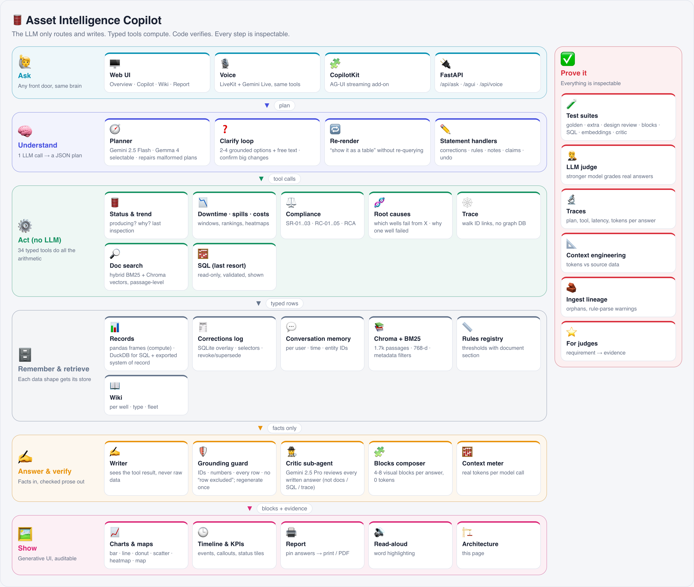

# Architecture: structure-first Asset Intelligence engine


*Poster generated from `static/js/poster.js` (also live in the app: Architecture > Poster; each card links to the page where that component can be inspected).*

Priority order: **accuracy > data pipeline > context management > orchestration > UI.** The LLM is a thin planner and
writer; every number comes from deterministic code over typed stores. Status tags: `[built]` (everything below is built unless marked otherwise).
Last updated: 17 Oct 2026, 15:45.

## 1. Pick the store by the shape of the data
| Data | Shape | Store | Why |
|---|---|---|---|
| Inspections (~40k), maintenance (~5.7k), regulator events, wells | Relational, time-series, joined by IDs | pandas frames at run time **and** DuckDB `data/store.duckdb` rebuilt by every ingest `[built]` | Exact aggregation is the job. DuckDB gives a SQL system of record with provenance; golden tests cross-check a SQL query against the tool result. No server DB at this scale. Inspection -> repair -> report -> regulator event links are plain IDs (joins), so no graph DB. |
| Rules (thresholds, deadlines) | Key/value with provenance | `rules` registry: value + source document section (e.g. `T200.md §9.3`, `spill-response-sop.md §4 (SR-01)`) `[built]` | Parsed from manual/SOP text at load, with a warning and default if wording differs. Answers cite the section. |
| Manuals, SOPs, repair reports, notes | Semi-structured / free text | Chunks (by section) with applicability metadata (well, well type); **hybrid**: BM25 + `text-embedding-005` vectors in **Chroma** (persistent, metadata filters, high-recall HNSW), merged by reciprocal rank, boosted for the well's own records and for the governing manual/SOP on rule questions `[built]` | BM25 nails exact tokens (SR-01, MNT-0001-029); embeddings catch paraphrase. Chroma is built from the on-disk embedding cache (so nothing is re-embedded) and is browsable in Audit > Vector store. |
| Corrections, shared notes, rule overrides, claims | Append-only audit log | SQLite `facts` overlay: selector, op, value, scope, author, reason, status (active / superseded / revoked) `[built]` | See section 3. |
| Private conversations | Per-user event log with timestamps | SQLite `convo`: user, chat, time, tool, entity IDs per answer `[built]` | See section 3. |
| Wiki pages (per well / type / fleet) | Derived views | `copilot/wiki.py`: live facts block + cached, checked model-written insights `[built]` | See section 4c. |

## 2. Ingestion pipeline (one re-runnable command over any number of dataset roots)
1. Locate roots (accepts repo root, `sample-data`, or nested), load JSON/JSONL, dedupe by primary key (later root wins), merge areas/teams/users by ID. `[built]`
2. Parse rules from manual/SOP text with provenance; warn and fall back instead of crashing. `[built]`
3. Lift facts from reports (containment hours) and notes. `[built]`
4. Chunk and embed docs (cached; only new chunks are embedded when test data is added). `[built]`
5. Persist normalised tables and a `rules` table to DuckDB. `[built]`
6. Validate with golden tests (Q1-Q15 plus SQL cross-check), 22 extra scenarios with independent ground truth, fake-test-dataset load. `[built]`

"Today" is one config value (`COPILOT_TODAY`, default 2026-10-17). Windows ("last 4 months") anchor on the previous day, the last
day of data, which reproduces the stated Q6 window (16 Jun to 16 Oct).

## 3. Corrections, rules, feedback and recall (the hard part)
**Unstructured -> structured.** Free text never lives in the relational store as meaning. At ingest it is lifted into typed
fields (containment hours), and at run time one extraction step turns a user sentence into a typed record (scope, field,
operation, value, validity, author, reason). The original text stays linked for the "why" questions.

**One feedback, many rows.** A correction carries a *selector* (wells / area / well type / date range / inspection IDs /
column filters like `method=manual`) and an operation (`set`, `add`, `mul`). It is evaluated against the raw rows when read, so
one record can change hundreds of rows and nothing is overwritten. An empty selector matches nothing (never the whole fleet).
**Precedence and conflicts:** least specific first so the most specific, then the latest, wins; overlapping corrections with
different values are reported as conflicts. **Lifecycle:** a new correction on the same selector+field supersedes the old one;
"undo that correction" revokes; revoked and superseded rows stay in the log for audit and stop affecting answers. `[built]`
**Rules** (e.g. RCA after 2 repairs for T350) are scoped to a well type and labelled in answers as the user's rule, not the manual. `[built]`
**Claims** (e.g. "WELL-0175 is running fine") are compared with the latest inspection and stored confirmed or unconfirmed, with
other users' conflicting statements listed. `[built]` A "Knowledge & corrections" panel shows everything taught, status badges,
conflicts, and a Revoke button. `[built]`

**"The wells we discussed" (even months later).** Each answer stores timestamp, tool and the entity IDs it returned, under the
asking user. Recall resolves only from that user's history, filtering by time phrase (yesterday / last week / last month / a month
name) and by count ("three wells"). If several different sets match, it uses the latest and lists the others; if none match the
time window it says so and falls back to the latest matching set. No history means it says so and asks. History is kept
indefinitely (a few bytes per answer). `[built]` No mem0: this is one indexed lookup, exact, with no extra LLM call.

## 3b. Concept questions ("which wells are failing due to mud?") and links
Free-text concepts are answered by **lifting text into structure at ingest, then querying structure**, with hybrid search only for discovery:
1. Ingest extracts each report's *Root cause* section into a column (the sample has about 25 distinct phrasings across 1.5k reports). `[built]`
2. Query `wells_by_cause(concept)`: shortlist the distinct phrasings (lexical overlap plus embeddings when there are many), one small LLM call judges
   which are *exact* or *related* to the concept and gives a one-line reason, then SQL-style aggregation returns wells, report counts, cost, last date
   and a verbatim quote per row. `[built]`
3. If the literal word never occurs (in the sample "mud" appears in no record) the answer says so, shows the closest kinds with counts
   (sand / scale / paraffin) and does not invent matches. `[built]`
4. Why hybrid: BM25 finds exact tokens (IDs, "stuffing box"), embeddings find meaning ("sludge" vs "sand and scale"), and structured columns turn the
   hits into exact counts. Each does what the others cannot. LLM tokens are spent on 25 phrases, not 1.5k reports.
**Graph DB: not needed.** The graph is the ID links (note/correction -> inspection -> repair -> report -> regulator event). `trace(entity_id)` walks
them and returns every linked record, which covers impact and provenance questions. `[built]`

## 3c. The central knowledge base (the "wiki" idea, stated precisely)
One corpus, three layers, all with provenance: (1) **facts**: the append-only corrections / rules / notes / claims table (the audited source of
truth for anything users teach, viewable and revocable in the Knowledge panel) `[built]`; (2) **derived views**: effective inspections, rules registry,
root-cause column, entity links, rebuilt on every ingest and on every correction `[built]`; (3) **compiled pages**: per-well / per-type / fleet dossiers
generated from layers 1-2 (facts block is deterministic, the LLM-written insight block is labelled, cited and checked) `[built]`. Corrections are thus applied
once, at the scope they were given, and flow into every later answer and page.

## 3d. Clarification, confirmation and modes `[built]`
The planner may answer with `clarify`: one short question, 2-4 options (best guess first, grounded in the data, with counts or dates) plus free text; the next message is read as the
answer and merged with the original request. Triggers: the request is ambiguous in a way that changes the answer; an unknown area or well (close matches offered); several earlier
sets of wells match "the wells we discussed"; a word never occurs in the data ("mud": the closest root causes with report/well counts are offered); a change would touch more than 150
rows (Apply to all N / narrow it). `COPILOT_CLARIFY=auto` (used by the graded run harness) never asks: it picks the best default and shows "Assumed: ...". Visual guide: `docs/DIAGRAMS.md`.

## 4. Orchestration (small, specialised, mostly deterministic)
The real flow in `copilot/agent.py` (`Agent.ask`):
```
 message -> [confirm/cancel shortcut if a large change is pending]
         -> Planner: 1 LLM call (Gemini 2.5 Flash, JSON mode; Gemma 4 selectable) -> plan
              normalize_plan() repairs malformed plans (e.g. the tool name used as the plan kind); invalid kind -> one retry;
              kind "clarify" in auto mode -> forced best-guess plan with an "Assumed: ..." line
         -> dispatch: query | rerender | correct_raw | correct_ai | rule | note | revoke | clarify
         -> Executor (no LLM): up to 4 tool calls; unknown area/well -> clarify (ask) or a plain answer (auto)
              45 tools incl. hybrid search_docs, root_causes, trace and the last-resort read-only sql_query
         -> blocks.py composes 4-8 visualization blocks from the tool result (no LLM)
         -> Writer: 1 LLM call, sees only the tool result (max 30 rows / 7,000 chars)
         -> Grounding guard (code): IDs and numbers must appear in the result, every row mentioned, no "this row does not qualify";
              fails -> regenerate once -> else deterministic template
         -> Critic sub-agent: Gemini 2.5 Pro reviews the draft (skipped for search_docs / sql_query / trace / root_causes);
              flags -> one rewrite, accepted only if it passes the guard
         -> lead line "Wells: ..." (2+ wells) and notes that name IDs or decimal figures the prose left out are appended
         -> response {text, visual, rows, blocks, citations, notes, plan, context}; context = real tokens per call
```
Typical answer = 3 model calls (router, writer, critic); table/chart/map/heatmap/timeline cost no tokens. Every answer is appended to `traces.jsonl` (plan, blocks, evidence, latency, tokens).
LangGraph was considered and not used: the flow is small enough to stay plain Python.

## 4b. UI `[built]`
One build-free UI served by the backend (see README). Overview reads `/api/briefing` (deterministic, cached until the corrections log changes); Copilot posts to `/api/ask` and renders
the typed spec through the shared renderer registry; Knowledge reads `/api/facts`. The corrected-inspections table is cached on the corrections-log signature, which makes every tool and
the dashboard fast. The CopilotKit + AG-UI front end in `web/` is an optional add-on that hosts the same shared block renderer (`static/js/blocks.js`), so nothing is duplicated (DRY).

### Blocks: several visualizations per answer `[built]`
`copilot/blocks.py` turns a tool result into 4-8 typed blocks (kpis, callout, status, table, bar, line, donut, scatter, heatmap, map, timeline), e.g. well status = status tiles + callouts + trend + scatter + timeline + map. The backend owns the composition (testable, no LLM); the front ends only render. Compound questions concatenate the blocks of each part; re-rendering swaps the primary block without re-querying.

## 4c. Wiki, audit, voice `[built]`
**Wiki** (`copilot/wiki.py`): per-well / per-type / fleet pages. Facts are rebuilt on every request from the records and the corrections log, so a correction taught at any scope shows up immediately on the pages
it applies to; insights are LLM-written once, checked against the facts and cached on the facts fingerprint (stale badge when facts change). The fleet page is the central corrections / rules / process corpus.
**Audit** (`copilot/audit.py`): read-only endpoints for traces, ingest lineage, rules, tools, prompts, memory, evaluations and health, so every answer can be traced to its plan, data and checks.
**Voice** (`voice/agent.py`): LiveKit + Gemini Live; one tool (`ask_copilot`) calls the same backend, results are pushed to the browser as blocks.

## 4d. QA and open-ended analysis `[built]`
Quality is checked at three levels: deterministic scenario suites with independent ground truth (50 core scenarios + extended), a runtime grounding guard on every answer, and an LLM judge
(stronger model, 5-criterion rubric) over real answers with the real-vs-expected view in the UI and `docs/QA_REPORT.md`. `sql_query` is the open-ended escape hatch: model-written read-only SQL, validated by code,
shown to the user, labelled ad-hoc. Typed tools stay first choice (a test asserts that a covered question does not route to SQL).

## 5. Context and token management
Router prompt is fixed (about 2k tokens, cache-friendly) and never contains dataset content. The writer gets only the tool
result (top 30 rows plus aggregates). Conversation context is the last 4 turns, trimmed; continuity comes from entity IDs, not
transcript replay. `NO_WRITER=1` runs router-only for benchmarks. `[built]`

## 6. Accuracy controls
Golden tests, 22 extra scenarios checked against independent pandas ground truth (`tests/extra/truth.py`), SQL cross-check,
grounding check on prose, "no recorded reason" instead of guessing, conflicts shown not silently resolved, fake test-dataset
load. Final-run harness `tests/run_final.py` (fresh memory, ordered questions, markdown output for page 2). `[built]`

## 7. Models
Primary: Gemini 2.5 Flash on Vertex AI (JSON mode). Selectable: **Gemma 4 26B-A4B on Vertex AI** (`COPILOT_BACKEND=gemma`). Fallback:
free OpenRouter models. Router-only benchmark over 40 scenarios (`tests/bench_router.py`):
| Backend | Right tool/kind | Right tool + key args |
|---|---|---|
| Gemini 2.5 Flash | 40/40 | 40/40 |
| Gemma 4 26B-A4B | 35/40 | 33/40 |
(last saved run, `tests/results/router-*.json`; a model-based benchmark, so it varies a little between runs)
The LLM role is thin (route + write), which is why a small open model gets close.

## 8. Ideas taken from the Gemini build guide
State-drift detector (recorded status vs inspections) `[built]`; UI chosen by data shape `[built]`; chart switching in chat `[built]`;
reasoning trace (the "How I answered" and "Context used" panels) `[built]`; zero-prompt morning briefing (Overview) `[built]`; printable report `[built]`; SLA countdown for reportable spills not built (not in the requirements); AG-UI/A2UI idea: our typed spec `[built]`, plus a CopilotKit/AG-UI front end in `web/` `[built]`. Dropped: pressure/flow sensors (data only has temperature).

## 9. Award mapping
1. **Asset Intelligence Copilot:** all of the above.
2. **Best use of Gemma 4:** Gemma 4 runs the planner/writer on Vertex with a measured router benchmark against Gemini.
3. **Best open-source AI project:** Chroma (vector store), DuckDB, rank-bm25, CopilotKit + AG-UI, LiveKit Agents, Mermaid, Playwright; embeddings via Vertex today, EmbeddingGemma would be a drop-in.


## Test-data additions `[built]`
- Ingest: SR-01 deadline chosen by discovery date (24 h before 1 Jan 2027, 12 h after, parsed from the SOP); `data_correction` notes override recorded values; `type_history` picks the threshold at the reading time; `team_history`; plugged wells excluded from status lists; `Parts installed` lines parsed from reports.
- `copilot/ops.py`: eleven tools that read the Operations SOP, MOC memos, the supplier recall notice and the regulator letter from their text. Long audit tables are answered with deterministic text (no LLM) so no row can be dropped.
- Memory: per-user display preferences (private), second-hand claims stored as unverified and not applied, per-request chat context (contextvar) so parallel chats never mix.
- UI: multi-chat history (`/api/chats`), interactive blocks (`static/js/blocks.js`).
