# Asset Intelligence Copilot: visual guide

Colour key used in every diagram: 🟧 user / UI · 🟪 LLM (thin: plan + write) · 🟩 deterministic code · ⬜ stores · 🟥 guards.

## 1. The whole system in one picture
The LLM only plans and writes. Every number comes from code over typed stores, and a guard checks the prose before it is shown.

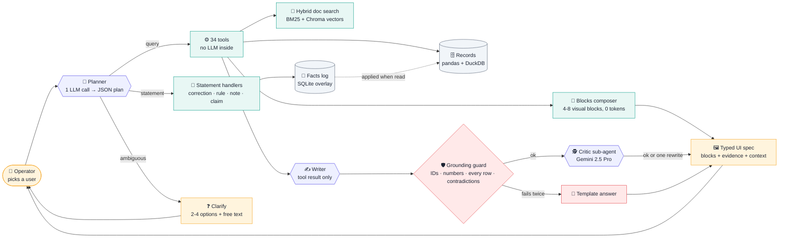

## 2. Each kind of data gets the store that fits its shape
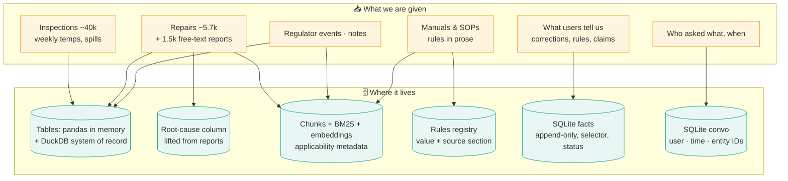
No vector server, no graph DB, no NoSQL: the data is small, structured, and linked by plain IDs.

## 3. Ingestion: one command over any number of dataset roots
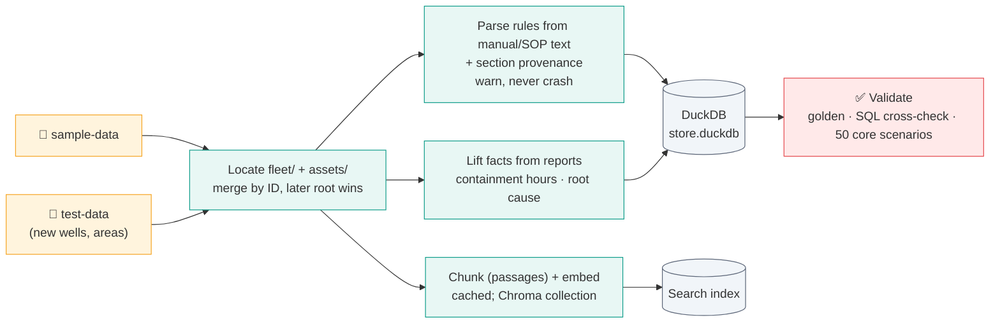

## 4. Corrections are an overlay, never an overwrite
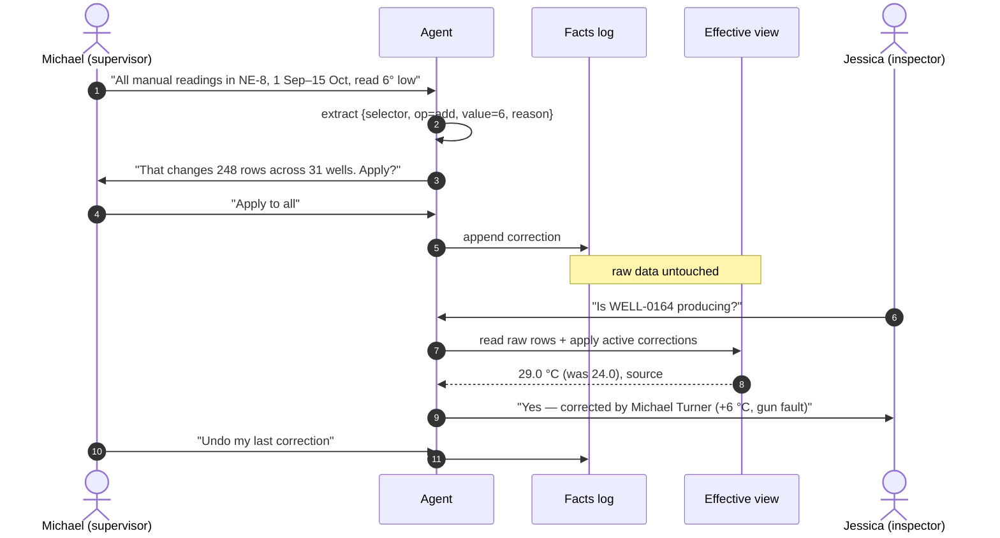

## 5. Correction lifecycle and who wins
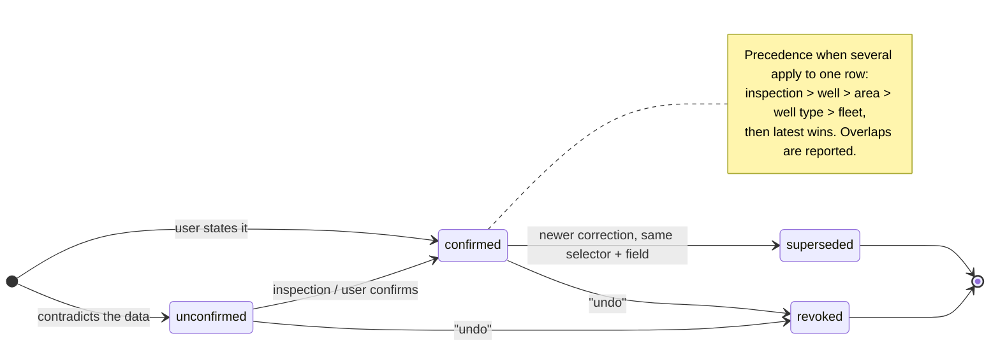

## 6. "The wells we discussed…", even months later
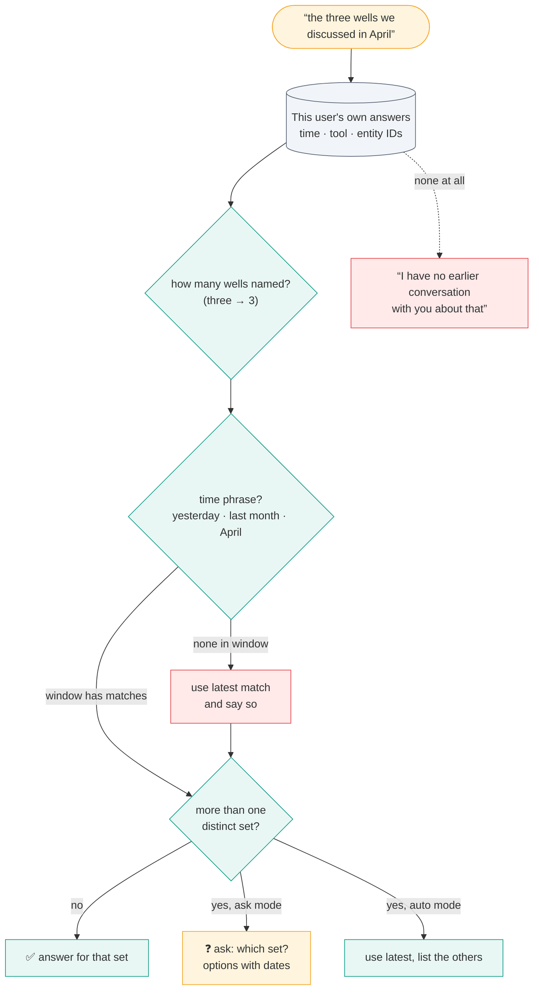

## 7. The clarification loop
One short question, grounded options, free text always allowed. In `auto` mode (no human, e.g. the graded run) it never asks and states its assumption instead.
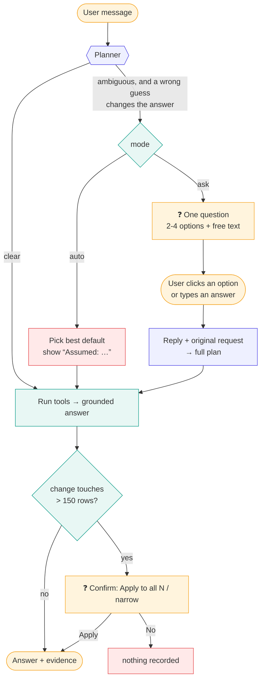

## 8. “Which wells are failing due to mud?”: text lifted into structure
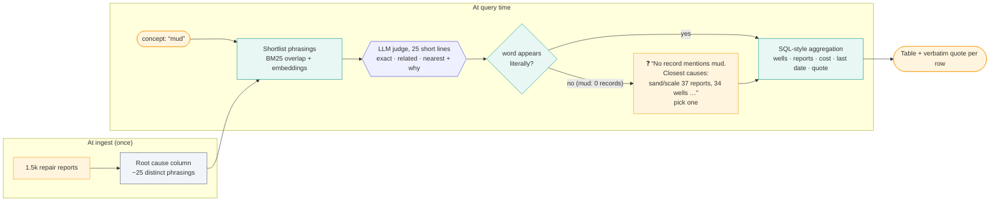

## 9. Why hybrid search (and a graph without a graph DB)
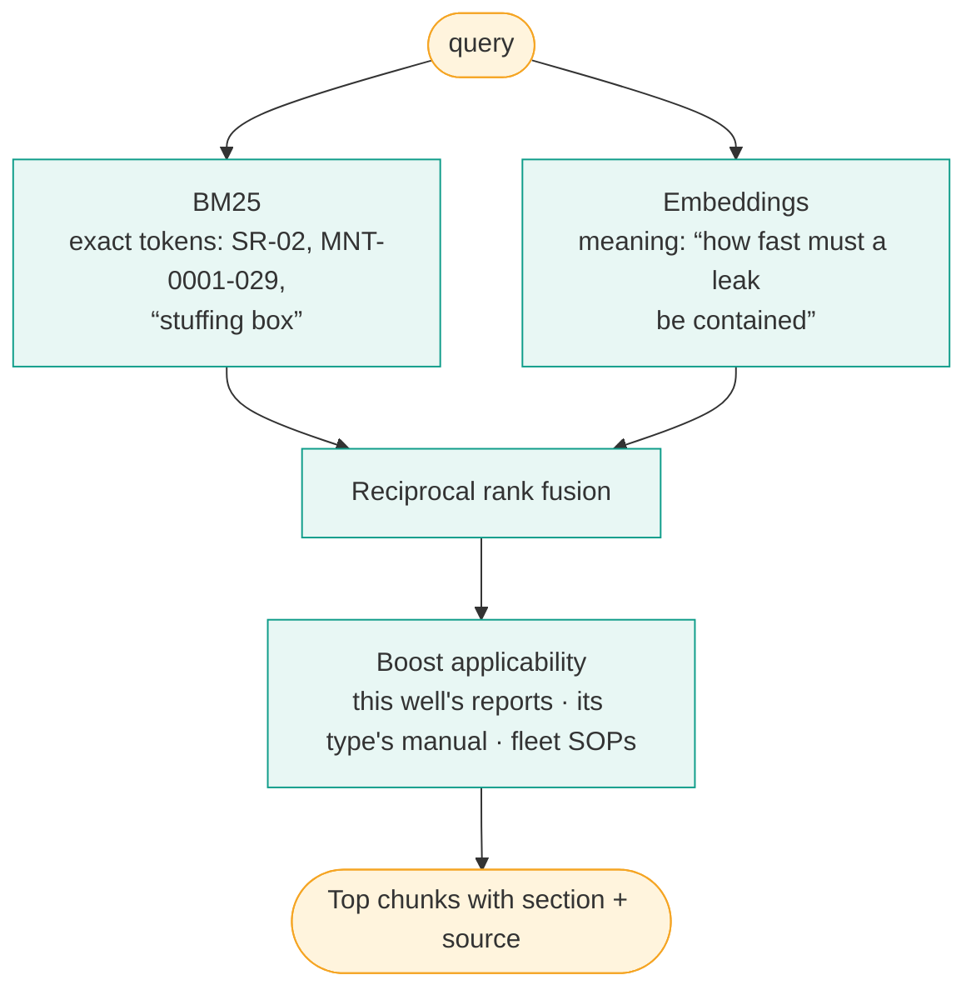
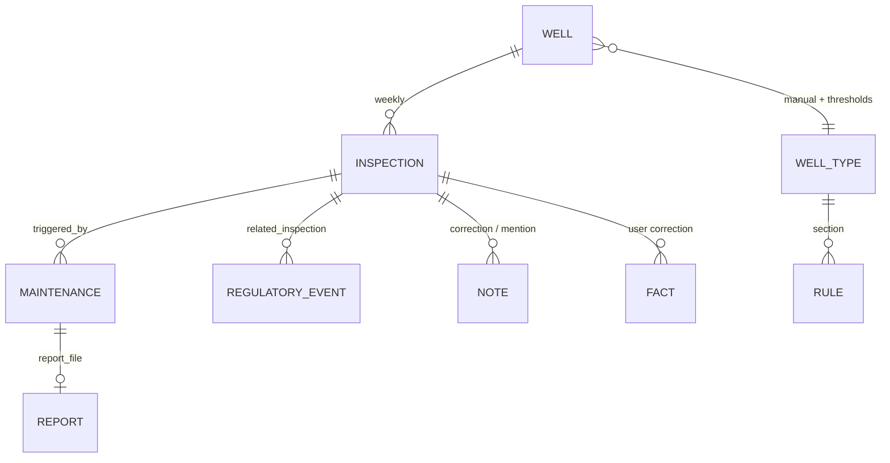
`trace(entity_id)` walks these ID links, so impact and provenance questions need no graph database.

## 10. One answer, many visualizations
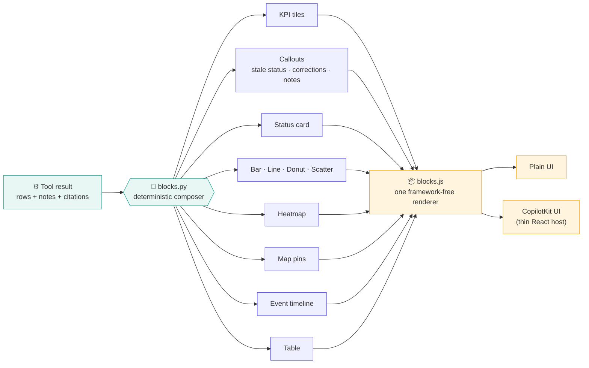

## 11. Evidence: scenarios and models
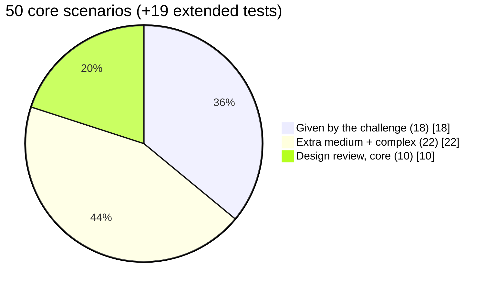
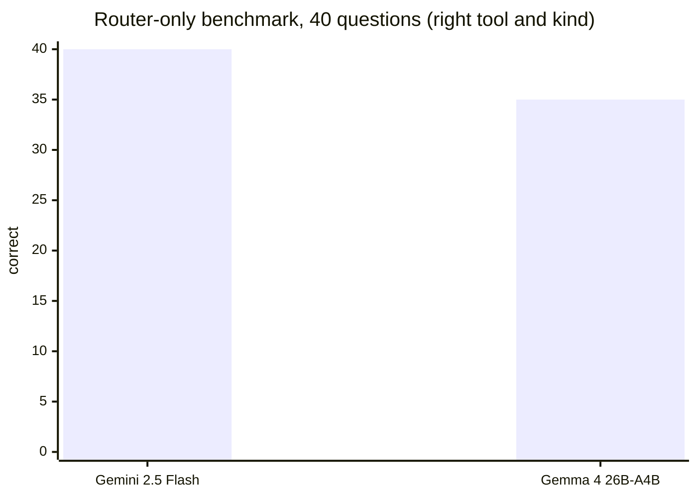
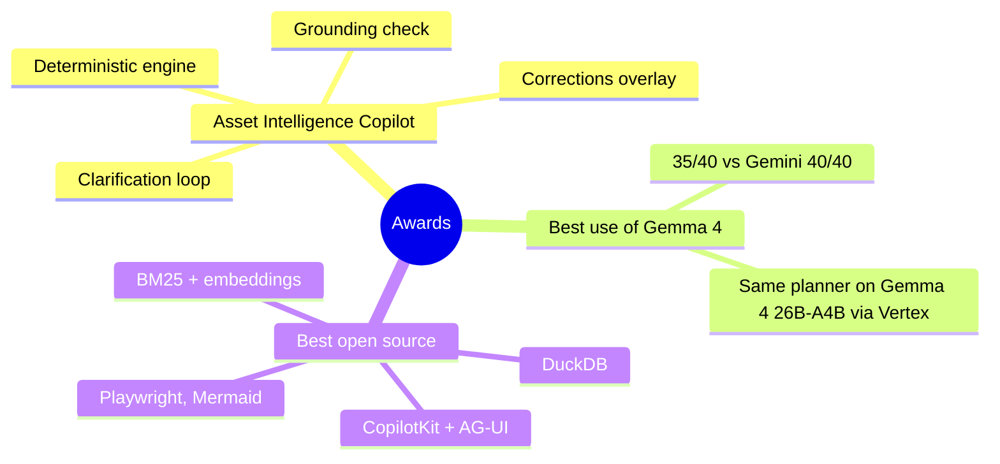
